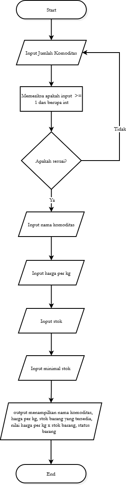

PROGRAM PENGELOLAAN STOK KOMODITAS
==================================

DESKRIPSI
---------
Program ini dibuat dengan bahasa Scala 3 untuk mengelola data stok komoditas
(misalnya beras, gula, minyak goreng, telur). Pengguna memasukkan data lewat
terminal, lalu program langsung menampilkan hasil pengolahannya: nilai stok
dalam rupiah, status stok tiap komoditas, dan total seluruh stok.

CARA MENJALANKAN
----------------
Prasyarat:
  - Scala 3 dan scala-cli sudah terpasang
    (https://scala-cli.virtuslab.org)
  - File program: StokKomoditas.scala

Langkah:
  1. Buka terminal pada folder yang berisi StokKomoditas.scala.
  2. Jalankan perintah:

         scala-cli run StokKomoditas.scala

  3. Ikuti instruksi di layar:
       - Masukkan jumlah komoditas yang ingin diinput.
       - Untuk setiap komoditas, isi:
           * Nama komoditas
           * Harga per kg
           * Stok
           * Stok minimum
  4. Setelah semua data dimasukkan, hasil langsung ditampilkan.

CONTOH INPUT DAN OUTPUT
-----------------------
Input:
  Jumlah komoditas yang diinput: 2

  --- Komoditas ke-1 ---
  Nama komoditas : Beras
  Harga per kg   : 10000
  Stok           : 100
  Stok minimum   : 50

  --- Komoditas ke-2 ---
  Nama komoditas : Minyak Goreng
  Harga per kg   : 15000
  Stok           : 15
  Stok minimum   : 20

Output:  
=== HASIL DATA STOK ===  
  Nama       : Beras  
  Stok       : 100  
  Harga/kg   : Rp10000  
  Nilai stok : Rp1000000  
  Status     : Stok Aman
  ----------------------  
  Nama       : Minyak Goreng  
  Stok       : 15  
  Harga/kg   : Rp15000  
  Nilai stok : Rp225000  
  Status     : Stok Menipis
  ----------------------
  Total seluruh stok: 115

| Flowchart |
|---------|
| 

FITUR
-----
1. Input data dari terminal
   Data komoditas dimasukkan langsung oleh pengguna, tanpa data bawaan.

2. Validasi input
   Teks kosong atau angka tidak valid (huruf, angka negatif) akan ditanyakan
   ulang sampai input benar.

3. Perhitungan nilai stok
   Nilai stok = harga per kg x stok, ditampilkan dalam format rupiah.

4. Status stok
   - Stok Habis    : stok sama dengan 0
   - Stok Menipis  : stok kurang dari atau sama dengan stok minimum
   - Stok Aman     : stok di atas stok minimum

5. Total seluruh stok
   Jumlah stok semua komoditas dihitung secara rekursif.

KONSEP PEMROGRAMAN FUNGSIONAL YANG DIGUNAKAN
--------------------------------------------
1. Function value / lambda
   hitungNilaiStok dan formatRupiah disimpan sebagai val berisi lambda.

2. Higher-Order Function
   foreach menerima fungsi (lambda) sebagai parameter.

3. Pure function
   cekStatus, hitungNilaiStok, formatRupiah, dan totalStok tidak memiliki
   efek samping.

4. Data immutable
   Hanya memakai val dan List. Penambahan data membuat list baru dengan
   operator ::, bukan mengubah list lama.

5. Conditional expression
   if / else if / else pada cekStatus menghasilkan nilai String.

6. Pengolahan String dan List
   Interpolasi string, trim, nonEmpty, toIntOption, reverse, foreach.

7. Function composition
   hitungDanFormat menggabungkan hitungNilaiStok dan formatRupiah
   menggunakan andThen.

8. Chaining
   Contoh: Option(readLine()).getOrElse("").trim

9. Recursive method
   totalStok memiliki base case (list kosong / Nil) dan recursive case
   (proses elemen pertama, lalu panggil diri dengan sisa list).
   bacaSemua, bacaTeks, dan bacaAngka juga rekursif dengan @tailrec.

10. Output yang jelas
    Setiap komoditas ditampilkan lengkap dengan nilai stok dan statusnya,
    diakhiri total seluruh stok.

STRUKTUR FILE
-------------
  StokKomoditas.scala   Kode program utama
  README.txt            Dokumen ini# miniprojek-Fungpro
